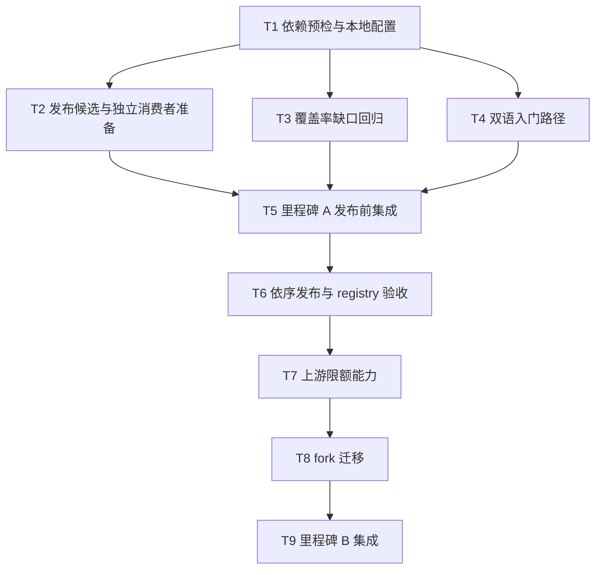

# Redis Event Bus 依赖、验证与文档改进实施计划

> **面向执行者：** 本计划对应 [设计文档](design-20261013T100011170Z-920897a9.md)。逐项执行并在每项后记录真实命令、退出码与结果。本文仅是实施计划；本次任务只授权写入这两份文档，未授权发布、提交、推送或删除重要文件。后续实施时遵守当时的用户授权与仓库规则。

**目标：** 恢复无需本地 patch 的独立安装与当前版本 CI/覆盖率门禁，补全双语 README 调用链，并在保留 RESP 帧限额的前提下最终移除 `qubit-redis` fork。

**架构：** 里程碑 A 先建立可信的 registry 依赖和验证链，保持现有 `qubit-redis` 运行语义；双语 README 与覆盖率回归可在依赖预检后并行推进。里程碑 B 待上游提供等价的帧限额 API 后迁移到上游客户端，独立验收通过后退出 fork。

**技术栈：** Rust 1.94、Cargo、Redis Streams 6.2/7、Sentinel、rustls、项目 `.infra` 工具、现有 Markdown 示例测试。

**工作目录：** `/data/working/qubit/rust-common/rs-event-bus-redis`。用户指定在当前 Paseo workspace 工作；不新建 Paseo workspace，也不把设计或计划搬到临时目录。

## 全局约束

- 当前包版本为 `qubit-event-bus-redis` 0.7.0；依赖先决包当前写为 `qubit-redis =0.32.7-qubit.1`。执行时先查 registry，不能假定这两个版本已发布。
- 保留 `redis.max_wire_bytes + 65,536` 的接收 RESP 帧界限，超限时停止订阅、断开该接收连接，且不得凭不完整响应 ACK 或隔离 PEL 条目。
- 保留同步与异步、独立 Redis 与 Sentinel、TLS、wire v1、至少一次投递、未知结果和 settlement 意图语义，除非迁移任务有明确的破坏性变更及下游迁移说明。
- 不以 `rs-task` 或 fixture 的本地 `[patch.crates-io]` 证明对外安装。独立验收必须从 registry 解析，无 path/patch。
- 测试新增路径应先复现失败或未覆盖语义，再做最小修正；不为提高覆盖率写只镜像实现的测试。
- 英文与中文 README 分别写自然文字，版本、公开 API、代码、错误边界和链接语义一致。
- `git add`、`git commit`、`git push`、包发布和重要源码删除均不属于本次写文档授权；未来执行者需依据其实施任务授权和届时规则判断。

## 文件与职责映射

| 文件 | 预期责任 |
| --- | --- |
| `Cargo.toml`、`Cargo.lock` | 依赖版本、feature、解析来源与发布候选 |
| `.cargo/config.toml`（被忽略） | 仅开发者本地 Cargo 覆盖；先审查再处理，不纳入发布包 |
| `ci/prepare-event-bus.sh`、`.github/workflows/ci.yml` | 预检与无 patch 安装验收入口 |
| `tests/fixtures/registry_consumer/Cargo.toml`、`tests/fixtures/registry_consumer/src/main.rs`（新建） | 发布后在仓库外复制运行的纯 registry 消费者；fixture 自身不得使用 path/patch |
| `tests/redis_fault_tests.rs`、`tests/wire_limit_tests.rs`、对应 `src/tests/` | 有意义的故障、接收帧和恢复回归 |
| `README.md`、`README.zh_CN.md` | 订单场景的正文 Quick Start 与发布状态 |
| `tests/documentation/markdown_examples_tests.rs` | 从双语 README 抽取、组装并编译新示例 |
| `doc/user_guide*.md`、`doc/design*.md`、`doc/migration*.md`、`doc/coverage-review*.md` | 版本、限制、迁移和当前验证证据一致性 |
| `src/client.rs`、`src/client/internal/sentinel_resolver.rs` | 里程碑 B 的客户端构造及接收帧限额迁移 |
| `third_party/redis-rs/`、`rs-task/Cargo.toml` | fork 退出后移除 vendored 源及下游本地 patch；只在完整 B 验收后处理 |

## 调度图

同一并行批次的写入集合互不相交。涉及 Cargo 构建的任务共用 `target/` 资源组，重型命令按任务顺序串行；完整 CI、coverage、Clippy、Rustdoc 仅由集成任务执行。

| 任务 | 前置任务 | 最小解锁产物 | 写入集合 | 本地验证 | 集成验证归属 | 审查时机 |
| --- | --- | --- | --- | --- | --- | --- |
| T1 依赖预检与本地配置 | 无 | 包名正确、可解释的本地解析；registry 状态记录 | `ci/prepare-event-bus.sh`、本地 `.cargo/config.toml`（如获授权） | `cargo metadata --locked`；配置故障回归 | T5 | 立即审查 |
| T2 发布候选与独立消费者准备 | T1 | package 候选与无 patch 消费者 fixture 就绪 | `Cargo.toml`、`Cargo.lock`、`tests/fixtures/registry_consumer/`、CI 验收入口 | `cargo package --list`；fixture 静态核查 | T5；发布后由 T6 运行 | 立即审查 |
| T3 覆盖率缺口回归 | T1 | 可重复的聚焦故障测试 | `tests/redis_fault_tests.rs`、`tests/wire_limit_tests.rs`、确有需要的相邻测试/源码 | 聚焦 `cargo test --test ...` | T5 | 批量审查；与 T2/T4 同批 |
| T4 双语入门路径 | T1 | 双语 README 调用链和示例提取测试 | `README.md`、`README.zh_CN.md`、`tests/documentation/markdown_examples_tests.rs`、相关指南 | 文档示例聚焦测试 | T5 | 批量审查；与 T2/T3 同批 |
| T5 里程碑 A 发布前集成 | T2、T3、T4 | 当前版本 CI/coverage 与 package 候选证据 | `doc/coverage-review*.md`、受影响的设计/迁移文档 | 文档链接、版本与结果核对 | 本任务唯一运行发布前完整 CI/coverage | 立即审查 |
| T6 依序发布与 registry 验收 | T5 | `qubit-redis` 和 provider 均可从 registry 解析；纯 registry 消费者通过 | README 安装状态、CI 发布后验收配置、锁文件 | 独立 `cargo check --locked` 的 sync/async/default 三组 | 里程碑 A 发布后验证归本任务 | 立即审查；外部发布门禁 |
| T7 上游限额能力 | T6 | 已发布并经测试的上游等价 API | 上游 `redis-rs` 贡献仓库；本仓库只记录版本证据 | 上游同步/异步 parser 测试 | T9 | 立即审查；外部前置门禁 |
| T8 fork 迁移 | T7 | 上游依赖下全功能与边界测试通过 | `Cargo.toml`、`Cargo.lock`、`src/client.rs`、`src/client/internal/sentinel_resolver.rs`、`rs-task/Cargo.toml`、相关 fixture 与文档；`third_party/redis-rs/` 退出 | 帧限额、Redis/Sentinel/TLS 和下游聚焦测试 | T9 | 立即审查 |
| T9 里程碑 B 集成 | T8 | 无 fork、无 patch 的发布候选与门禁证据 | `doc/coverage-review*.md`、`doc/design*.md`、`doc/migration*.md`、双语 README | 独立 registry 消费者和 package 检查 | 本任务唯一运行迁移后完整 CI/coverage | 立即审查 |

## 任务拓扑依赖图



## 任务步骤

### T1：依赖预检与本地配置

**文件：** `ci/prepare-event-bus.sh`；本地 `.cargo/config.toml` 仅在查清来源并获得实施授权后修改。

- [ ] 记录 `git status --short`、`git rev-parse HEAD`、`cargo +1.94.0 --version`，读取被忽略的 `.cargo/config.toml`，核对其 `[patch.crates-io]` 键与 `third_party/redis-rs/Cargo.toml` 的 `package.name`。预期当前键 `redis` 与真实包名 `qubit-redis` 不匹配。
- [ ] 查询 crates.io 稀疏索引及 `cargo metadata --locked`，分别记录 `qubit-redis`、provider 与 core 的版本是否存在。索引 HTTP 404 与 Cargo 找不到包应被写成“截至检查日未解析”，不可推断未来发布状态。
- [ ] 在 `ci/prepare-event-bus.sh` 中增加不泄露密钥的预检：若本地 config 把 `redis` patch 到包名 `qubit-redis` 的 vendored 路径，则明确报出文件、键与修正方向并在调用 Cargo 前退出；不修改其他本地配置。用一份专用临时配置 fixture 分别检验旧键被拒绝、正确键通过。
- [ ] 在获得处理该忽略文件的实施授权后，修正为 `qubit-redis = { path = "third_party/redis-rs" }` 或保留用户配置并从无该覆盖的环境运行开发测试；记录采取的方式。**不得**把此 patch 当成 T6 的纯 registry 验收。
- [ ] 运行 `cargo metadata --locked --format-version 1`；预期在显式本地开发模式下解析成功，且预检对错误键给出可读错误。若 registry 仍无包而无本地 patch，此命令应明确标为依赖门禁未满足。

### T2：发布候选与独立消费者准备

**文件：** `Cargo.toml`、`Cargo.lock`、`tests/fixtures/registry_consumer/Cargo.toml`、`tests/fixtures/registry_consumer/src/main.rs`、`.github/workflows/ci.yml` 或其现有 CI hook。

- [ ] 核对 `third_party/redis-rs/Cargo.toml` 的版本、许可与包内容；用 `cargo package --manifest-path third_party/redis-rs/Cargo.toml --list` 检查发布候选。准备 `qubit-redis` 和 provider 两个包的元数据、版本与发布顺序记录，**此任务不发布包**。
- [ ] 创建 `registry_consumer`：`Cargo.toml` 仅列 `qubit-event-bus`、`qubit-event-bus-redis`、`qubit-spi` 的准确 registry 版本，独立 `[workspace]`，**无** `path` 与 `[patch.crates-io]`；`main.rs` 使用 README 对外展示的 provider 选择和 facade 初始化路径。验证脚本复制该 fixture 到仓库外目录，并检查不存在本地 path/patch 后才运行 Cargo。

  fixture 的 feature 转发固定为以下结构；版本号采用实际通过 T1 核实的对应发布版本，且与 README 完全一致：

  ```toml
  [features]
  default = ["sync", "async", "discovery"]
  sync = ["qubit-event-bus-redis/sync"]
  async = ["qubit-event-bus-redis/async"]
  discovery = ["qubit-event-bus/discovery", "qubit-event-bus-redis/discovery"]
  ```

  `main.rs` 至少要编译 `qubit_event_bus_redis as _` 的发现注册、`EventBusRegistry::discover()` 与 `AsyncEventBusRegistry::discover()` 对应 feature 路径；完整发布/消费行为仍由现有文档示例与 Redis 集成测试负责。
- [ ] 发布前对 provider 运行 `cargo package --list` 和 `cargo package --allow-dirty` 的候选检查，核对包内文件与依赖声明；若依赖尚未发布导致 package 校验无法完成，则如实记录阻断，不能把本地 path/patch 构建写成纯 registry 成功。
- [ ] 将 registry 消费者的发布后执行命令加入 CI 文档或发布验收入口，但仅由 T6 在两个包实际发布后运行；既有本地 path/patch fixture 继续作为开发回归，不代替它。

### T3：覆盖率缺口回归

**文件：** `tests/redis_fault_tests.rs`、`tests/wire_limit_tests.rs`、必要时相邻的 `src/tests/` 或实现文件。

- [ ] 在 T1 可构建环境中重新生成当前源码 coverage 原始报告，按文件与源函数归并 29 个未覆盖函数；记录能否由公开 SPI 输入触达，不把 LLVM 生成闭包计为独立业务缺口。
- [ ] 优先为可达的同步接收/结算、异步取消、帧超限或恢复失败路径补聚焦用例。每个用例先指定 Redis 指令序列或故障注入、预期 `SpiError` kind/retryability、PEL 与连接结果；运行目标测试确认新用例在修复前确实失败，或在仅补覆盖时证明它执行了目标分支。
- [ ] 仅当用例暴露真实缺陷时修改最小生产代码，再运行对应目标测试。例如：`cargo +1.94.0 test --test redis_fault_tests --all-features --locked -- --test-threads=1` 和 `cargo +1.94.0 test --test wire_limit_tests --all-features --locked -- --test-threads=1`。不要在本任务并行运行完整 coverage。
- [ ] 将仍不可达的错误映射或平台故障列为有原因的剩余项；若确属死代码，单独评估删除，不能把删除当作覆盖率优化的默认动作。

### T4：双语 README 入门路径

**文件：** `README.md`、`README.zh_CN.md`、`tests/documentation/markdown_examples_tests.rs`，必要时指南中的链接或版本文字。

- [ ] 以 `doc/user_guide.md` / `.zh_CN.md` 已有 `codec` 与 `sync-discovery` 场景为事实源，选用订单发布与 `billing` 持久组消费。README 正文应按顺序给出依赖、唯一 namespace、codec、`redis-streams` 选择、发布、消费结果、关闭；避免要求读者先打开示例文件才能看到关键调用。
- [ ] 先扩展 Markdown 示例提取测试，给 README 的 Rust 块专用标记，检查英文与中文使用相同可编译代码、公开 API 与可观察结果。测试运行 `cargo +1.94.0 test --test documentation_tests --all-features --locked` 或承载提取逻辑的精确测试目标；预期新增块前失败，加入后通过。
- [ ] 分别改写两个 Quick Start 的说明文字，标明调用发生的程序位置、Redis 预条件、成功信号和已有消费组游标策略。保留仓库 example 命令作为补充，并链接对应语言的详细用户指南。
- [ ] 发布状态未满足时，安装段落明确写“该版本尚未通过纯 registry 验收”；T6 的发布后验证通过才改为无需 patch 的直接安装陈述。检查文档内相对链接和标题锚点。

### T5：里程碑 A 发布前集成验证与记录

**文件：** `doc/coverage-review.md`、`doc/coverage-review.zh_CN.md`，以及受 T2/T4 事实变化影响的双语设计、迁移文档。

- [ ] 复核 T2、T3、T4 写入集合的 diff、版本、包来源、文档示例与测试证据；确认没有局部 patch 被用作独立安装结果。
- [ ] 串行运行 `./.infra/bin/ci-check.sh` 与 `./.infra/bin/coverage.sh`，记录退出码、HEAD、函数/行/区域分子分母和门槛。若 `ci-check.sh` 已内含 coverage，避免重复计数，并以该次完整运行结果为准。
- [ ] 完整运行 Docker 支撑的文档示例测试、feature 矩阵、Clippy、Rustdoc 与 package 检查（以项目 CI 输出为准）；单独验证 `rs-task/tests/redis_task_outbox_tests.rs` 中的 Redis 真实集成路径。
- [ ] 更新双语 coverage review 的当前证据段，保留历史记录的明确标签。当前完整门禁通过时只能称“发布候选就绪”；纯 registry 消费者仍由 T6 在发布后验证，不能提前宣称里程碑 A 完成。

### T6：依序发布与 registry 验收

**文件：** `README.md`、`README.zh_CN.md`、`Cargo.lock`、T2 创建的 registry 消费者 fixture 与发布后 CI 验收入口。

- [ ] 在 T5 门禁通过且取得届时明确的外部发布授权后，先发布 `qubit-redis` 候选版本；等待 crates.io 索引可解析并核对版本、checksum。若发布未获授权或索引不可解析，保留 T5 候选证据，停止本任务。
- [ ] 使用已发布的先决包对 provider 再运行 package 检查；核对依赖版本、锁文件与双语安装文字后，在独立授权范围内发布 provider 版本。不能先发布 provider 再等待先决包。
- [ ] 将 `registry_consumer` 复制到无父级 `.cargo/config.toml` 的仓库外目录，生成该消费者自己的锁文件，再分别运行 `cargo +1.94.0 check --locked --no-default-features --features sync,discovery`、`cargo +1.94.0 check --locked --no-default-features --features async,discovery` 与 `cargo +1.94.0 check --locked`；按 fixture 的 feature 转发定义执行，确保三条命令确实改变 provider feature。检查 `cargo tree` 无 path/patch。
- [ ] 三组均通过后，把双语 README 的安装段落改成已验证的直接安装表述；记录 registry 版本、验证日期、命令与退出码。至此才能标记里程碑 A 完成。

### T7：上游限额能力

**文件：** 上游 `redis-rs` 对应连接配置、同步 parser、异步 codec 及测试；本仓库仅记录上游 issue/PR、版本与 API 证据。

- [ ] 以当前 fork 的 `set_max_response_bytes` 差异为基准提交上游提案，明确单 RESP 帧限额、同步与异步构造 API、超限错误、连接失效和取消行为；附上已有 parser 测试的最小复现。
- [ ] 在上游实现中验证恰好等于限额、超过限额、分片输入、数组/嵌套帧、超限后的连接不可复用、TLS 和异步取消。运行上游聚焦测试，并记录合入 commit 与包含该 API 的正式版本。
- [ ] 若上游拒绝或长期无可用版本，停止 T8，记录阻断原因并另开替代客户端/受限传输层设计；**不**通过移除限额来解锁 T8。T6 成果仍可独立使用。

### T8：迁移并退出 fork

**文件：** `Cargo.toml`、`Cargo.lock`、`src/client.rs`、`src/client/internal/sentinel_resolver.rs`、相关 `tests/`、`rs-task/Cargo.toml`、fixture manifest、双语文档及 `third_party/redis-rs/`。

- [ ] 先写针对上游版本的编译与行为回归：独立 Redis、Sentinel、TLS 的同步/异步接收都能在响应构造前拒绝超限帧；PEL 条目仍在，错误类别和连接失效与设计一致。聚焦运行 `wire_limit_tests`、`tls_transport_tests`、`tls_sentinel_tests` 和 Sentinel 测试，记录迁移前基线。
- [ ] 将依赖改为上游 `redis` 已发布版本，替换两处构造 API，逐项核对 feature、TLS 根证书、ACL、超时与取消语义。若上游 API 引入必须的破坏性配置变更，同步更新双语迁移指南和 README。
- [ ] 调整 `rs-task` 与独立 fixture 的 package patch，仅在 `cargo tree` 与纯 registry 消费者证明不再引用 `qubit-redis` 后移除 vendored fork。删除受版本控制的 fork 源码须在未来实施授权内明确执行；本计划不执行删除。
- [ ] 运行聚焦回归以及 `rs-task` outbox 的失联、重复投递、TLS 场景，确认未知 XADD/XACK 结果和下游去重边界不变。

### T9：里程碑 B 集成与退出验收

**文件：** `doc/coverage-review*.md`、`doc/design*.md`、`doc/migration*.md`、双语 README，以及受结果影响的 CI 配置。

- [ ] 从干净独立消费者构建上游依赖版本，检查 `cargo tree`、package 内容与锁文件无 `qubit-redis`/本地 patch；核对双语文档删除 fork 待办标记，并准确描述新的限额 API 所依赖的上游版本。
- [ ] 串行运行完整 `.infra/bin/ci-check.sh`、coverage、文档示例、feature 矩阵、Docker Redis/Sentinel/TLS 回归及 `rs-task` 集成测试；记录真实输出，不沿用 T5 或历史通过率。
- [ ] 若任一帧限额、PEL、TLS/Sentinel 或未知结果回归失败，恢复到 T6 验证过的 `qubit-redis` 依赖基线，保留失败证据；只有全部验收通过才宣布 fork 退出。
- [ ] 以当前验证日期更新覆盖率与设计文档；发布上游依赖后的 provider 版本需另有外部发布授权和独立 registry 消费者复验。

## 规格覆盖自检

| 设计要求 | 对应任务与门禁 |
| --- | --- |
| 修正本地陈旧 patch、明确 registry 状态 | T1；T6 的纯 registry 构建 |
| 先发布先决包、再验证 provider 独立安装 | T2 候选；T5 发布前门禁；T6 发布及验收 |
| 当前源码覆盖率达到项目门槛且测试有行为价值 | T3；T5 完整 coverage |
| 双语 README 正文调用链与可编译示例 | T4；T5 文档测试 |
| 维持 RESP 接收帧边界并最终移除 fork | T7；T8；T9 |
| 下游 outbox、Sentinel、TLS 与错误语义 | T5；T8；T9 |

本计划含外部发布与上游合入前置条件。实施者应在对应门禁处记录可审查的阻断证据，不能以本地 patch、未发布版本或降低帧限额伪造完成。

## 本轮执行记录（2026-10-13）

| 阶段 | 状态 | 证据 / 未完成原因 |
| --- | --- | --- |
| T1 | 已完成（本地开发路径） | `ci/prepare-event-bus.sh` 检出错误 patch 键；本地 `qubit-redis` patch 仅供开发与 CI 构建。纯 registry 解析仍不可用。 |
| T2 | 已完成（候选与门禁） | 独立 registry consumer fixture、静态禁止 path/patch 检查及发布后 CI 验收入口已加入；`cargo package --verify` 通过。 |
| T3 | 已复查 | 定向 wire-limit / 故障回归及全量覆盖率门槛通过；未发现可安全、真实触达且需要额外生产改动的缺口，因此没有为提高数字而添加无意义注入接口。 |
| T4 | 已完成 | 双语 Quick Start 与 Markdown 示例提取/执行测试完成；完整 CI 中相关 Redis 示例测试通过。 |
| T5 | 已完成 | `.infra/bin/align-ci.sh` 与 `.infra/bin/ci-check.sh` 依序通过。覆盖率：函数 522/548（95.26%），行 5,087/5,291（96.14%），区域 7,827/8,240（94.99%）。本地源码 patch 仅支持本地构建，不能充当 registry 验收。 |
| T6 | 阻塞：registry 包未发布 | 检查时 crates.io 索引无法解析 `qubit-redis` 和 provider；没有可供无 patch 消费者验证的已发布候选。本轮未执行外部发布。 |
| T7 | 阻塞：上游帧限额能力未具备 | 上游依赖没有已验证的同步/异步单 RESP 帧限额 API。本轮保留 fork 及接收帧限额，不执行迁移。 |
| T8–T9 | 未执行（依赖 T7） | 在上游能力具备前移除 fork 会丢失设计要求保护的帧上限；不得据此宣称里程碑 B 完成。 |

完整 CI 最终以状态 0 退出，覆盖默认/feature matrix、文档 Redis 示例、package 校验、fuzz smoke、覆盖率和依赖审计。一次初始运行暴露的同步测试调度抖动，通过将测试 gate 等待预算由 1 秒增至 3 秒修复；独立测试与完整 no-default sync workspace 回归通过。

